# Esquema entidad–relación de Miscelánea Ari

## Diagrama

El siguiente diagrama está escrito en Mermaid ER. Se puede abrir directamente en un visor compatible con Mermaid o pegarlo en Mermaid Live Editor para exportarlo como SVG o PNG.

```mermaid
erDiagram
    Categories {
        TEXT CategoryId PK
        TEXT Name
        TEXT NormalizedName UK
    }

    Products {
        TEXT ProductId PK
        TEXT Name
        INTEGER SalePriceMinorUnits
        INTEGER StockMilliUnits
        TEXT Unit
        TEXT CategoryId FK
        INTEGER MinimumStockMilliUnits
        INTEGER IsActive
    }

    UserAccounts {
        TEXT UserId PK
        TEXT CoordinatorUserId UK
        TEXT UserName
        TEXT NormalizedUserName UK
        BLOB PasswordSalt
        BLOB PasswordHash
        INTEGER PasswordIterations
        INTEGER Role
        INTEGER IsEnabled
        INTEGER CreatedAtUtc
    }

    Customers {
        TEXT CustomerId PK
        TEXT Name
        TEXT NormalizedName UK
        TEXT Phone
        INTEGER CreatedAtUtc
    }

    Purchases {
        TEXT OperationId PK
        INTEGER OccurredAtUtc
        TEXT ActorUserId FK
    }

    PurchaseLines {
        TEXT OperationId PK, FK
        INTEGER LineNumber PK
        TEXT ProductId FK
        TEXT ProductNameSnapshot
        TEXT UnitSnapshot
        INTEGER QuantityMilliUnits
    }

    Sales {
        TEXT OperationId PK
        INTEGER OccurredAtUtc
        TEXT ActorUserId FK
        INTEGER TotalMinorUnits
        INTEGER IsCredit
        TEXT CustomerId FK
    }

    SaleLines {
        TEXT OperationId PK, FK
        INTEGER LineNumber PK
        TEXT ProductId FK
        TEXT ProductNameSnapshot
        TEXT UnitSnapshot
        INTEGER QuantityMilliUnits
        INTEGER SalePriceMinorUnits
        INTEGER LineTotalMinorUnits
    }

    Receivables {
        TEXT OperationId PK, FK
        TEXT CustomerId FK
        INTEGER OriginalAmountMinorUnits
        INTEGER OutstandingMinorUnits
        INTEGER DueAtUtc
    }

    Payments {
        TEXT PaymentId PK
        TEXT OperationId FK
        TEXT ActorUserId FK
        INTEGER AmountMinorUnits
        INTEGER OccurredAtUtc
    }

    InventoryMovements {
        TEXT MovementId PK
        TEXT OperationId
        INTEGER LineNumber
        TEXT ProductId FK
        TEXT ProductNameSnapshot
        TEXT UnitSnapshot
        INTEGER Type
        INTEGER QuantityMilliUnits
        TEXT Reason
        INTEGER OccurredAtUtc
        TEXT ActorUserId FK
    }

    InventoryDiscrepancies {
        TEXT DiscrepancyId PK
        TEXT OperationId
        TEXT ProductId FK
        TEXT ActorUserId FK
        INTEGER ShortageMilliUnits
        INTEGER CreatedAtUtc
        INTEGER IsResolved
    }

    DeviceIdentity {
        INTEGER SingletonKey PK
        TEXT DeviceId UK
        INTEGER CreatedAtUtc
    }

    OutboxMessages {
        TEXT OperationId PK
        TEXT DeviceId
        TEXT ActorUserId
        TEXT OperationType
        TEXT PayloadJson
        INTEGER CreatedAtUtc
        INTEGER Status
        INTEGER AttemptCount
        INTEGER LastAttemptAtUtc
        INTEGER ConfirmedAtUtc
        TEXT LastError
    }

    DeviceSyncStates {
        TEXT DeviceId PK
        INTEGER LastSequence
        INTEGER LastSuccessfulSyncAtUtc
    }

    DeviceSyncConflicts {
        TEXT ConflictId PK
        INTEGER CoordinatorSequence
        TEXT OperationId UK
        TEXT OperationType
        TEXT PayloadJson
        TEXT Message
        INTEGER CreatedAtUtc
        INTEGER IsResolved
    }

    CoordinatorOperations {
        INTEGER Sequence PK
        TEXT OperationId UK
        TEXT DeviceId
        TEXT ActorUserId
        TEXT OperationType
        TEXT PayloadJson
        BLOB PayloadHash
        INTEGER CreatedAtUtc
        INTEGER ReceivedAtUtc
        INTEGER Status
        TEXT ConflictMessage
    }

    PendingDevicePairings {
        TEXT PairingId PK
        BLOB Salt
        BLOB CodeHash
        INTEGER CreatedAtUtc
        INTEGER ExpiresAtUtc
        INTEGER RedeemedAtUtc
    }

    AuthorizedDevices {
        TEXT DeviceId PK
        BLOB TokenHash
        INTEGER AuthorizedAtUtc
        INTEGER IsRevoked
    }

    CoordinatorUserSessions {
        BLOB TokenHash PK
        TEXT DeviceId
        TEXT UserId
        INTEGER CreatedAtUtc
        INTEGER ExpiresAtUtc
        INTEGER RevokedAtUtc
    }

    Categories ||--o{ Products : "clasifica"
    Products ||--o{ PurchaseLines : "aparece en"
    Purchases ||--|{ PurchaseLines : "contiene"
    UserAccounts ||--o{ Purchases : "registra"
    Products ||--o{ SaleLines : "se vende en"
    Sales ||--|{ SaleLines : "contiene"
    UserAccounts ||--o{ Sales : "registra"
    Customers o|--o{ Sales : "compra"
    Sales ||--o| Receivables : "genera"
    Customers ||--o{ Receivables : "adeuda"
    Receivables ||--o{ Payments : "recibe"
    UserAccounts ||--o{ Payments : "registra"
    Products o|--o{ InventoryMovements : "afecta"
    UserAccounts ||--o{ InventoryMovements : "registra"
    Products ||--o{ InventoryDiscrepancies : "presenta"
    UserAccounts ||--o{ InventoryDiscrepancies : "registra"
```

También está disponible el archivo Mermaid independiente: [esquema-entidad-relacion.mmd](esquema-entidad-relacion.mmd).

## Cómo leerlo

- `PK`: clave primaria. `FK`: clave foránea configurada en la base. `UK`: columna con índice único.
- En `PurchaseLines` y `SaleLines`, la clave primaria se compone de `OperationId` y `LineNumber`.
- `TEXT`, `INTEGER` y `BLOB` son los tipos de almacenamiento de SQLite. Los UUID se guardan como texto; fechas UTC se guardan como números enteros; los importes se expresan en unidades monetarias menores y las cantidades en milésimas de la unidad del producto.
- `Sales.CustomerId` y `InventoryMovements.ProductId` son opcionales. Una salida de merma mixta puede no asociarse con un producto específico.
- Las tablas de negocio y seguimiento local se crean en las bases SQLite de la aplicación. La base del coordinador incorpora además `CoordinatorOperations`, `PendingDevicePairings`, `AuthorizedDevices` y `CoordinatorUserSessions`.
- El diagrama dibuja las claves foráneas reales configuradas en EF Core. Identificadores como `DeviceId` y `ActorUserId` en la cola, el diario del coordinador y las sesiones son referencias lógicas entre componentes; esas tablas no tienen claves foráneas SQL declaradas hacia las demás.

## Fuente del esquema

El esquema se documentó desde `LocalDbContext.OnModelCreating`, las entidades de persistencia, las migraciones de EF Core y las sentencias de creación de tablas del coordinador. Representa la estructura prevista por el código y no requiere que la base actual contenga datos. Antes de presentarlo como esquema definitivo de la instalación, se recomienda contrastarlo con las migraciones aplicadas en la base central.
