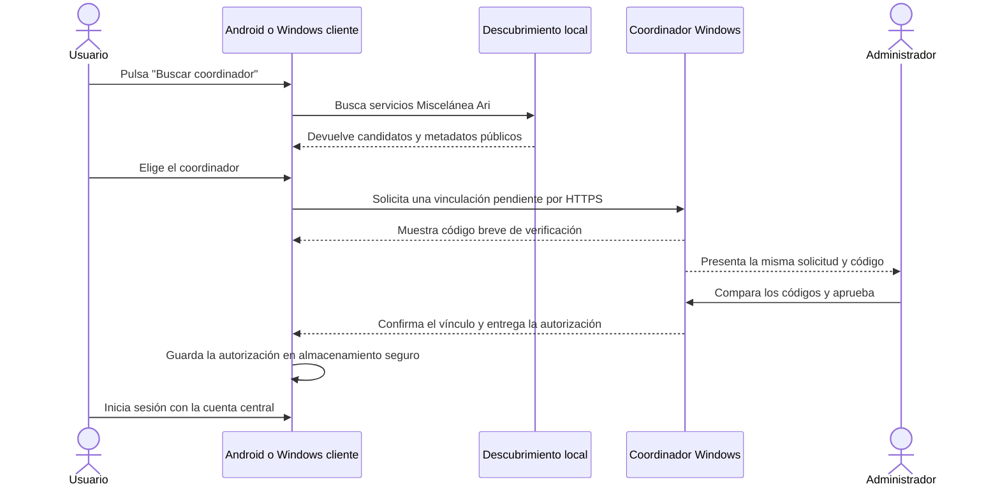

# Plan de implementación: descubrir y vincular el coordinador LAN

**Estado:** Planificado; implementación aún no iniciada  
**Fecha:** 18 de octubre de 2026  
**Alcance:** agregar el descubrimiento automático como una tercera forma de localizar y vincular un dispositivo. La vinculación por QR y la configuración manual deben seguir disponibles.

## Objetivo

En un dispositivo conectado a la red local del negocio, el usuario podrá pulsar **Buscar coordinador**, elegir el coordinador Windows encontrado y solicitar la vinculación sin escribir su dirección IP ni copiar archivos. El coordinador deberá pedir una aprobación explícita de un Administrador antes de autorizar el dispositivo. Después de vincularlo, el usuario inicia sesión con su cuenta central mediante el flujo ya existente.

El descubrimiento solo localiza el servicio. Estar en la misma Wi-Fi no identifica al equipo como confiable, no autentica una cuenta y no concede permiso para sincronizar.

## Reglas que no se deben romper

- [ ] Mantener los flujos actuales de **QR** y **configuración manual**; la nueva opción se agrega, no los reemplaza.
- [ ] No vincular automáticamente al encontrar un servicio. La persona debe elegir el coordinador y un Administrador debe aprobar la solicitud.
- [ ] No confiar en la red, el nombre mDNS ni los datos anunciados como prueba de identidad. Validar el coordinador mediante HTTPS y su certificado fijado; acordar y documentar cómo se establece esa confianza en el flujo sin QR.
- [ ] Antes de aprobar, usar un código breve de verificación visible tanto en el dispositivo que solicita el vínculo como en la pantalla del coordinador. El código debe derivarse de una prueba criptográfica ligada a la sesión de vinculación y a la identidad del coordinador; no basta con que el servidor envíe unos dígitos al cliente. La aprobación solo continúa si ambos códigos coinciden; si no coinciden, se cancela y no se envían secretos.
- [ ] Reutilizar el registro seguro de dispositivo y el token protegido existente. No registrar contraseñas, códigos, tokens, huellas completas ni datos de negocio en los anuncios de red o en registros de diagnóstico.
- [ ] Mantener separadas la vinculación del dispositivo y la autenticación del usuario. Descubrir o vincular un dispositivo no debe crear una cuenta, iniciar una sesión central ni importar datos previos automáticamente.
- [ ] No explorar rangos completos de direcciones IP. Usar descubrimiento de servicios en la LAN (mDNS/DNS-SD u otro estándar compatible que se justifique).
- [ ] Limitar anuncios y reglas de firewall a la red privada/local. No abrir el coordinador a Internet ni crear reenvíos de puertos.
- [ ] Tratar todos los valores anunciados y recibidos de la red como datos no confiables; validar formato, protocolo y versión antes de usarlos.

## Flujo esperado

Si la revisión de seguridad determina que el código breve no es suficiente para validar la identidad TLS con el certificado autofirmado actual, resolver esa brecha antes de implementar el vínculo automático. El Administrador y el cliente deben calcular el código de la misma negociación criptográfica; no debe ser un número elegido por el servidor y copiado al cliente. No desactivar ni saltarse la validación de certificado para hacer funcionar el descubrimiento.

## Progreso por etapas

Marca una casilla solo cuando el cambio y la evidencia indicados estén completos. Si algo falla, deja la casilla pendiente y registra el resultado en la bitácora al final.

### Etapa 0 — Confirmar diseño y límites de seguridad

- [ ] Revisar el flujo actual en `MauiApp1/Presentation/Views/DevicePairingPage.xaml` y `MauiApp1/Presentation/ViewModels/DevicePairingViewModel.cs`.
- [ ] Revisar `MauiApp1.Application/Lan/ICoordinatorPairingClient.cs`, `MauiApp1.Infrastructure/Lan/CoordinatorPairingClient.cs` y los endpoints de vinculación en `MauiApp1.Coordinator/Program.cs`.
- [ ] Documentar el protocolo para que una solicitud de descubrimiento obtenga aprobación de Administrador sin pedir que el cliente escriba IP, huella o código de ocho dígitos.
- [ ] Definir cómo se compara el código breve en ambos extremos y cómo se preserva la fijación HTTPS existente. El código debe quedar ligado criptográficamente a la negociación de esa solicitud para que un intermediario no pueda mostrar el mismo valor en dos conexiones separadas. La revisión debe cubrir suplantación mDNS, intermediario TLS, repetición de solicitudes, expiración y cancelación.
- [ ] Definir metadatos públicos mínimos del anuncio: nombre visible del coordinador, identificador no secreto, tipo y versión del servicio y puerto. No anunciar credenciales, códigos de emparejamiento, tokens, cuentas ni contenido de la base.
- [ ] Elegir la biblioteca/protocolo de DNS-SD solo después de verificar mantenimiento, licencia, compatibilidad con el servicio de Windows, Android y .NET MAUI. Registrar la decisión y alternativas en este documento.

**Salida de la etapa:** diseño del protocolo revisado y sus estados de error descritos. No comenzar la aprobación automática hasta resolver la confianza del certificado.

### Etapa 1 — Contratos compartidos

- [ ] Añadir en la capa `Application` contratos independientes de interfaz y plataforma para iniciar/detener búsqueda, recibir candidatos y cancelar una búsqueda.
- [ ] Definir modelos de candidato y solicitud con campos validados; no incluir secretos en `ToString`, serialización de diagnóstico ni mensajes de error.
- [ ] Definir resultados diferenciados: permiso requerido/denegado, búsqueda sin resultados, servicio inválido, múltiples coordinadores, cancelación, error de red y coordinador incompatible.
- [ ] Mantener el cliente actual de vinculación como autoridad para verificar certificado y completar el guardado seguro; evitar duplicar el protocolo de vínculo en el code-behind de la vista.
- [ ] Registrar dependencias mediante inyección en `MauiProgram`; mantener la lógica de negocio compartida y aislar las APIs específicas de cada plataforma.

### Etapa 2 — Anuncio desde el coordinador Windows

- [ ] Publicar el servicio DNS-SD solo mientras el coordinador está activo y puede responder en HTTPS.
- [ ] Anunciar metadatos mínimos y un identificador estable del coordinador; no incluir datos comerciales.
- [ ] Usar el puerto configurado por el servicio y comprobar que el destino anunciado sea la interfaz IPv4 privada correcta, incluso cuando Windows tenga varias interfaces, VPN o adaptadores virtuales.
- [ ] Retirar el anuncio al detener el servicio y actualizarlo al cambiar la interfaz o dirección de red.
- [ ] Comprobar el comportamiento al iniciar como Servicio de Windows (cuenta `LocalSystem`), reiniciar Windows y cambiar de Wi-Fi.
- [ ] Revisar si hace falta una regla de firewall de descubrimiento. Si se necesita, limitarla al tráfico mDNS/DNS-SD y al perfil Privado; no modificar el perfil de red del usuario ni abrir puertos públicos.

### Etapa 3 — Descubrimiento en los clientes

- [ ] Implementar descubrimiento Android con la API nativa NSD o una abstracción validada para MAUI.
- [ ] Implementar descubrimiento para Windows cliente y verificar que funcione en una PC instalada como Cliente, no solo en la PC Host.
- [ ] Consultar los permisos de red local requeridos según la versión y el `TargetSdkVersion` real del proyecto; pedirlos con explicación y manejar denegación sin bloquear QR o configuración manual.
- [ ] Gestionar el ciclo de vida: detener búsqueda al salir de la pantalla, cancelar callbacks al cerrar la página y volver a buscar al reanudar o cambiar de red.
- [ ] Resolver de nuevo la dirección actual de un servicio cuando cambie la red; no depender de una IP cacheada como identidad.
- [ ] Verificar que la búsqueda no anuncie ni seleccione la propia instalación y que descarte servicios con nombre, tipo, versión, puerto o metadatos inválidos.
- [ ] Mostrar un mensaje claro si el punto de acceso, router, VPN o aislamiento de clientes bloquea multicast; ofrecer QR y conexión manual como alternativas inmediatas.

### Etapa 4 — Solicitud, aprobación y confianza

- [ ] Añadir una solicitud de vínculo pendiente asociada a un identificador aleatorio, fecha de expiración y límite de intentos. Debe poder cancelarse y no autorizar nada por sí sola.
- [ ] Mostrar en la app del cliente el nombre del coordinador y el código de verificación breve ligado criptográficamente a la sesión pendiente.
- [ ] Mostrar al Administrador del coordinador la misma solicitud y el mismo código, junto con información mínima del dispositivo solicitante.
- [ ] Permitir al Administrador aprobar o rechazar. La aprobación debe expirar; una solicitud vencida o cancelada no puede convertirse en vínculo aunque se reintente una respuesta antigua.
- [ ] Después de aprobar, completar el intercambio por HTTPS con validación de certificado; guardar la identidad, dirección actual y token mediante `ICoordinatorLinkStorage`/`SecureStorage` siguiendo el patrón existente.
- [ ] Evitar crear una vinculación parcialmente confirmada si se pierde la red a mitad del flujo; permitir reanudar la misma solicitud de forma idempotente y segura.
- [ ] Confirmar que el mensaje final distinga **dispositivo vinculado** de **sesión de usuario iniciada** y de **sincronización completada**.

### Etapa 5 — Interfaz de usuario

- [ ] Agregar **Buscar coordinador en esta red** a la pantalla existente de vinculación, manteniendo visibles las acciones de escanear QR y usar datos manuales.
- [ ] Presentar estados: listo para buscar, buscando, resultados, ninguno encontrado, varios encontrados, solicitud pendiente, esperando aprobación, aprobado, rechazado, vencido y error recuperable.
- [ ] En la lista, identificar coordinadores sin exponer direcciones o huellas como texto obligatorio para el usuario común; mostrar detalles técnicos solo como información secundaria para soporte.
- [ ] Pedir confirmación al usuario antes de enviar la solicitud y explicar que el Administrador tendrá que aprobarla.
- [ ] Hacer la pantalla usable en Android y Windows: lista accesible, botones con estados de carga, cancelación y mensajes comprensibles.
- [ ] No alterar las acciones, permisos ni navegación de los flujos actuales de QR y configuración manual.

### Etapa 6 — Resiliencia y compatibilidad

- [ ] Manejar dos o más coordinadores en la misma LAN sin elegir uno automáticamente.
- [ ] Manejar cambios de IP, reconexión Wi-Fi, reinicio del coordinador, timeout, mensajes duplicados y callbacks tardíos.
- [ ] Limitar el volumen de solicitudes y proteger la aprobación contra fuerza bruta y reenvíos.
- [ ] No sobrescribir una vinculación confirmada o pendiente existente con un candidato descubierto distinto sin un flujo explícito de desvinculación o recuperación.
- [ ] Mantener accesibles la vinculación por QR y manual cuando el permiso de red se deniegue o multicast no funcione.
- [ ] Confirmar que una sesión de usuario vencida no se considera un fallo del descubrimiento y que descubrir un coordinador nunca inicia una sesión por sí mismo.

### Etapa 7 — Verificación

- [ ] Agregar pruebas unitarias para validación de anuncios, candidatos duplicados, expiración, cancelación, límites de intentos y estados de resultado.
- [ ] Agregar pruebas de protocolo para solicitud, aprobación, rechazo, reintento idempotente y certificado inválido.
- [ ] Compilar MAUI Android, MAUI Windows, coordinador y Setup/instalador; revisar warnings relevantes y manifiestos generados.
- [ ] Probar en la misma Wi-Fi: un coordinador y un Android; un coordinador y una PC Windows Cliente; después, tres dispositivos a la vez.
- [ ] Probar con hotspot de teléfono, sin Internet del ISP, varios coordinadores, coordinador detenido/iniciado, cambio de IP y cambio de red.
- [ ] Probar permiso Android denegado/concedido según el sistema operativo y el `TargetSdkVersion` publicado.
- [ ] Probar multicast bloqueado, aislamiento de clientes, VPN activa, firewall privado y firewall público. Confirmar que no se abre acceso externo.
- [ ] Probar anuncios falsos, huella/certificado incorrecto, endpoint HTTP, protocolo incompatible, código no coincidente, intento de intermediario que abre dos sesiones, aprobación desde otro coordinador, solicitud vencida y repetición de aprobación.
- [ ] Repetir el vínculo por QR y el vínculo manual para verificar que siguen funcionando sin cambios.
- [ ] Registrar evidencia reproducible de las pruebas físicas (versión de app/coordinador, Android, red y resultado); no marcar aceptación con solo una compilación o una prueba en localhost.

### Etapa 8 — Documentación y aceptación

- [ ] Actualizar `MauiApp1.Coordinator/Deployment/VINCULACION_LAN.md` con el nuevo flujo, aprobación del Administrador y limitaciones de descubrimiento.
- [ ] Actualizar `D:\Trabajo\Tesis\TASK.md` con el alcance, dependencias, criterios de aceptación y evidencia, sin marcar como terminadas las tareas que sigan pendientes.
- [ ] Documentar las reglas mínimas del firewall privado y la solución cuando mDNS no esté disponible; no pedir al usuario final ejecutar comandos de consola.
- [ ] Aceptar el cambio solo si el usuario puede descubrir y solicitar el coordinador sin escribir IP/huella/código, el Administrador aprueba conscientemente, se conserva la seguridad HTTPS y QR/manual siguen disponibles.

## Matriz de aceptación

| Escenario | Resultado esperado |
|---|---|
| Android y coordinador Windows en la misma LAN | El coordinador aparece; el usuario solicita vínculo; el Administrador aprueba; el teléfono queda vinculado. |
| PC Windows Cliente y coordinador en la misma LAN | Mismo flujo que Android, sin depender de que el cliente tenga una base central antigua. |
| Más de un coordinador encontrado | La app muestra cada candidato y espera que el usuario elija. |
| Coordinador no descubierto | Mensaje útil y acceso inmediato a QR y configuración manual. |
| Certificado no confiable o código de verificación distinto | Se cancela el flujo; no se guarda token ni autorización. |
| Solicitud no aprobada, rechazada o expirada | No se crea vínculo. |
| Vínculo correcto, cuenta no autenticada | Se informa que el dispositivo está vinculado y se mantiene el inicio de sesión central como paso separado. |
| Wi-Fi con multicast bloqueado o aislamiento entre clientes | Se explica que el descubrimiento no está disponible en esa red y se conservan los métodos alternativos. |

## Referencias de código actuales

- Contrato de vínculo: `MauiApp1.Application/Lan/ICoordinatorPairingClient.cs`.
- Cliente HTTPS, validación de IP local y certificado fijado: `MauiApp1.Infrastructure/Lan/CoordinatorPairingClient.cs`.
- Estado, QR, dirección y código actuales: `MauiApp1/Presentation/ViewModels/DevicePairingViewModel.cs`.
- Pantalla existente: `MauiApp1/Presentation/Views/DevicePairingPage.xaml`.
- Endpoints de salud y emparejamiento: `MauiApp1.Coordinator/Program.cs`.
- Guía operativa actual: `MauiApp1.Coordinator/Deployment/VINCULACION_LAN.md`.
- Tareas maestras de sincronización: `D:\Trabajo\Tesis\TASK.md`, en especial T7.1, T7.1.1 y T7.2.

## Referencias técnicas para revisar durante la implementación

- [Android: descubrimiento de servicios de red (NSD/DNS-SD)](https://developer.android.com/develop/connectivity/wifi/use-nsd).
- [Android: permisos de acceso a la red local](https://developer.android.com/privacy-and-security/local-network-permission). Verificar el requisito aplicable contra el `TargetSdkVersion` efectivo al implementar y publicar; no asumir que el comportamiento actual seguirá igual en futuras versiones de Android.

## Bitácora de implementación

| Fecha | Etapa | Cambio/evidencia | Responsable |
|---|---|---|---|
| — | — | Aún no se ha iniciado la implementación. | — |
