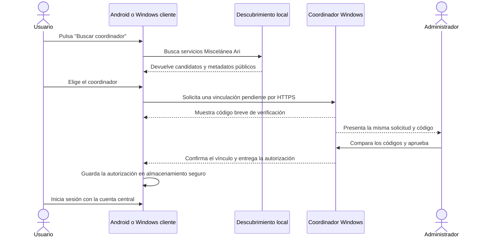

# Plan de implementación: descubrir y vincular el coordinador LAN

**Estado:** Implementado; pendiente de pruebas de protocolo y validación en dispositivos físicos
**Fecha:** 18 de octubre de 2026  
**Alcance:** agregar el descubrimiento automático como una tercera forma de localizar y vincular un dispositivo. La vinculación por QR y la configuración manual deben seguir disponibles.

## Objetivo

En un dispositivo conectado a la red local del negocio, el usuario podrá pulsar **Buscar coordinador**, elegir el coordinador Windows encontrado y solicitar la vinculación sin escribir su dirección IP ni copiar archivos. El coordinador deberá pedir una aprobación explícita de un Administrador antes de autorizar el dispositivo. Después de vincularlo, el usuario inicia sesión con su cuenta central mediante el flujo ya existente.

El descubrimiento solo localiza el servicio. Estar en la misma Wi-Fi no identifica al equipo como confiable, no autentica una cuenta y no concede permiso para sincronizar.

## Reglas que no se deben romper

- [x] Mantener los flujos actuales de **QR** y **configuración manual**; la nueva opción se agrega, no los reemplaza.
- [x] No vincular automáticamente al encontrar un servicio. La persona debe elegir el coordinador y un Administrador debe aprobar la solicitud.
- [x] No confiar en la red, el nombre mDNS ni los datos anunciados como prueba de identidad. Validar el coordinador mediante HTTPS y su certificado fijado; la confianza del flujo sin QR se establece con bootstrap aislado, ECDH y comparación criptográfica.
- [x] Antes de aprobar, mostrar en ambos extremos un código breve derivado de la clave efímera y la identidad del coordinador. La interfaz de Windows indica que se apruebe solo después de comparar; el token permanente no se envía antes de la aprobación.
- [x] Reutilizar el registro seguro de dispositivo y el token protegido existente. Los tipos con secretos ocultan esos valores en `ToString`; los anuncios y mensajes de diagnóstico no contienen credenciales, códigos, tokens ni huellas completas.
- [x] Mantener separadas la vinculación del dispositivo y la autenticación del usuario. Descubrir o vincular no crea una cuenta, inicia una sesión central ni importa datos previos.
- [x] No explorar rangos completos de direcciones IP. Usar mDNS/DNS-SD.
- [x] Limitar el anuncio y las reglas de firewall a la red privada/local. No se abre el coordinador a Internet ni se crean reenvíos de puertos.
- [x] Tratar los datos anunciados y recibidos como no confiables; se valida protocolo, versión, identificador, dirección, puerto y campos del handshake.

## Flujo esperado

Si la revisión de seguridad determina que el código breve no es suficiente para validar la identidad TLS con el certificado autofirmado actual, resolver esa brecha antes de implementar el vínculo automático. El Administrador y el cliente deben calcular el código de la misma negociación criptográfica; no debe ser un número elegido por el servidor y copiado al cliente. No desactivar ni saltarse la validación de certificado para hacer funcionar el descubrimiento.

## Progreso por etapas

Marca una casilla solo cuando el cambio y la evidencia indicados estén completos. Si algo falla, deja la casilla pendiente y registra el resultado en la bitácora al final.

### Etapa 0 — Confirmar diseño y límites de seguridad

- [x] Revisar el flujo actual en `MauiApp1/Presentation/Views/DevicePairingPage.xaml` y `MauiApp1/Presentation/ViewModels/DevicePairingViewModel.cs`.
- [x] Revisar `MauiApp1.Application/Lan/ICoordinatorPairingClient.cs`, `MauiApp1.Infrastructure/Lan/CoordinatorPairingClient.cs` y los endpoints de vinculación en `MauiApp1.Coordinator/Program.cs`.
- [x] Documentar el protocolo para que una solicitud de descubrimiento obtenga aprobación de Administrador sin pedir que el cliente escriba IP, huella o código de ocho dígitos.
- [x] Definir cómo se compara el código breve en ambos extremos y cómo se preserva la fijación HTTPS existente. El código debe quedar ligado criptográficamente a la negociación de esa solicitud para que un intermediario no pueda mostrar el mismo valor en dos conexiones separadas. La revisión debe cubrir suplantación mDNS, intermediario TLS, repetición de solicitudes, expiración y cancelación.
- [x] Definir metadatos públicos mínimos del anuncio: nombre visible del coordinador, identificador no secreto, tipo y versión del servicio y puerto. No anunciar credenciales, códigos de emparejamiento, tokens, cuentas ni contenido de la base.
- [x] Elegir la biblioteca/protocolo de DNS-SD solo después de verificar mantenimiento, licencia, compatibilidad con el servicio de Windows, Android y .NET MAUI. Registrar la decisión y alternativas en este documento.

#### Decisión de seguridad y transporte

El coordinador ASP.NET Core expone datos descriptivos del handshake TLS, pero su interfaz pública no entrega material de clave de sesión para derivar un código de comparación directamente del TLS. Por eso, la vinculación descubierta usará un intercambio efímero ECDH P-256 en la capa de aplicación, ligado a un identificador aleatorio de solicitud, al ID de dispositivo y a nonces de ambos extremos. Ambos extremos derivarán una clave y un código de comparación de ocho dígitos del mismo transcript criptográfico. El Administrador verá el código en Windows y solo aprobará si coincide visualmente con el que muestra el dispositivo.

El primer contacto de descubrimiento tendrá una ruta de bootstrap aislada, sin sesión de usuario ni token de dispositivo. La clave ECDH derivada protegerá con AES-GCM los mensajes posteriores del vínculo. La respuesta protegida incluirá la huella SHA-256 del certificado real del coordinador; el cliente la comparará con el certificado observado en ese contacto y solo entonces la guardará como pin. Todo el tráfico normal seguirá usando el cliente HTTPS con fijación estricta existente. La excepción de bootstrap nunca se usará para inicio de sesión, sincronización ni envío de credenciales. Un MITM que termine dos TLS distintos no podrá igualar el ECDH y el código; si el transcript o el código no coincide, se cancela sin enviar el token.

Las solicitudes tendrán ID aleatorio, límite de intentos y expiración corta; el coordinador las mantendrá en memoria para que un reinicio las invalide. La aprobación requiere autenticación de Administrador y queda asociada a una solicitud y dispositivo concretos. Repetir una solicitud vencida, aprobarla desde otro coordinador o reutilizar su respuesta no crea una autorización.

#### Decisión DNS-SD

Se usará `_miscelanea-ari-v1._tcp` por mDNS/DNS-SD. El servicio Windows y los clientes Windows usarán `Haukcode.Mdns` 1.0.21 (licencia MIT, código administrado, paquete `net8.0` compatible con los proyectos .NET 10; el repositorio publica actividad reciente y documenta anuncio y búsqueda para Windows). Android usará `NsdManager` nativo para respetar la API de descubrimiento del sistema y sus permisos de red local. El anuncio contendrá solo el nombre visible, el tipo/versión implícitos en el tipo de servicio y el puerto. La identidad no se confía al anuncio: la autentica el protocolo de vínculo anterior.

Alternativa descartada: resolver la IP desde el nombre mDNS y completar el vínculo con el código QR/manual existente. Eso facilita localizar el equipo, pero no cumple el objetivo de vincular sin transcribir códigos y deja al usuario a mitad del flujo. No se usará un escaneo de subred ni se aceptará automáticamente el certificado sugerido por mDNS.

**Salida de la etapa:** diseño definido antes de implementar la aprobación. El código de verificación requiere pruebas de protocolo en la etapa 7; no se considerará listo para despliegue hasta completarlas.

### Etapa 1 — Contratos compartidos

- [x] Añadir en la capa `Application` contratos independientes de interfaz y plataforma para buscar candidatos; la búsqueda tiene duración acotada y acepta cancelación.
- [x] Definir modelos de candidato y solicitud con campos validados; no incluir secretos en `ToString`, serialización de diagnóstico ni mensajes de error.
- [ ] Definir resultados diferenciados: permiso requerido/denegado, búsqueda sin resultados, servicio inválido, múltiples coordinadores, cancelación, error de red y coordinador incompatible.
- [x] Mantener el cliente de vinculación como autoridad para verificar certificado y completar el guardado seguro; la vista no implementa el protocolo criptográfico.
- [x] Registrar dependencias mediante inyección en `MauiProgram`; mantener la lógica de negocio compartida y aislar las APIs específicas de cada plataforma.

### Etapa 2 — Anuncio desde el coordinador Windows

- [x] Publicar el servicio DNS-SD solo mientras el coordinador está activo y puede responder en HTTPS.
- [x] Anunciar metadatos mínimos y un identificador estable del coordinador; no incluir datos comerciales.
- [ ] Usar el puerto configurado por el servicio y comprobar que el destino anunciado sea la interfaz IPv4 privada correcta, incluso cuando Windows tenga varias interfaces, VPN o adaptadores virtuales.
- [ ] Retirar el anuncio al detener el servicio y actualizarlo al cambiar la interfaz o dirección de red.
- [ ] Comprobar el comportamiento al iniciar como Servicio de Windows (cuenta `LocalSystem`), reiniciar Windows y cambiar de Wi-Fi.
- [x] Añadir la regla necesaria de firewall de descubrimiento: UDP 5353, ejecutable del coordinador, subred local y perfil Privado; no modificar el perfil de red ni abrir puertos públicos.

### Etapa 3 — Descubrimiento en los clientes

- [x] Implementar descubrimiento Android con `NsdManager`, usando resolución moderna en Android 14+ y la API compatible en versiones anteriores.
- [x] Implementar descubrimiento para Windows Cliente. La verificación en una PC instalada como Cliente queda pendiente.
- [x] Consultar el manifiesto compilado: el `TargetSdkVersion` efectivo es 36. Se incluye el permiso de multicast requerido por `MulticastLock`; la búsqueda NSD no solicita un permiso de ejecución en esta versión objetivo. Revisar de nuevo si el `TargetSdkVersion` sube a 37.
- [x] Cancelar la búsqueda en curso y sus callbacks al salir de la pantalla; reanudar la consulta de estado de una solicitud pendiente al volver.
- [ ] Volver a iniciar automáticamente la búsqueda al regresar a la página o cambiar de red.
- [x] Resolver de nuevo la dirección actual del servicio en cada búsqueda; no depender de una IP cacheada como identidad.
- [x] Evitar que el modo Host muestre el descubrimiento de clientes y filtrar servicios con nombre, tipo, versión, puerto, dirección o metadatos inválidos.
- [x] Mostrar un mensaje recuperable cuando no se encuentran coordinadores y conservar QR y conexión manual como alternativas.

### Etapa 4 — Solicitud, aprobación y confianza

- [x] Añadir una solicitud de vínculo efímera (ID aleatorio, tres minutos y límite de solicitudes/ritmo); se cancela y no autoriza por sí sola.
- [x] Mostrar en la app del cliente el coordinador seleccionado y el código de verificación breve ligado criptográficamente a la sesión pendiente.
- [x] Mostrar al Administrador del coordinador la misma solicitud y el código, junto con el nombre del dispositivo.
- [x] Permitir al Administrador aprobar o rechazar. Una solicitud vencida, cancelada o ya resuelta no puede convertirse en vínculo mediante una repetición.
- [x] Después de aprobar, completar el intercambio por HTTPS fijado; guardar identidad, dirección y token en almacenamiento seguro.
- [x] Si se pierde la red al completar, conservar una vinculación pendiente recuperable y reintentar de forma idempotente; la cancelación no puede competir con una autorización en curso.
- [x] Los mensajes distinguen dispositivo vinculado, inicio de sesión y sincronización.

### Etapa 5 — Interfaz de usuario

- [x] Agregar **Buscar coordinador en esta red** a la pantalla existente de vinculación, manteniendo las acciones de QR y configuración manual.
- [x] Presentar estados de búsqueda, resultados, ausencia o pluralidad de coordinadores, solicitud pendiente, espera de aprobación, aprobado, rechazado, vencido y error recuperable.
- [ ] Añadir mensajes tipificados que distingan de forma consistente permiso denegado, coordinador incompatible, error de red y multicast bloqueado.
- [x] En la lista, identificar coordinadores por nombre sin exigir que el usuario escriba la dirección o la huella.
- [x] Pedir confirmación antes de enviar la solicitud y explicar que el Administrador tendrá que aprobarla.
- [x] Adaptar la pantalla a Android y Windows con lista, estados de carga, cancelación y mensajes.
- [x] Mantener las acciones, permisos y navegación de los flujos existentes de QR y configuración manual.

### Etapa 6 — Resiliencia y compatibilidad

- [x] Manejar dos o más coordinadores en la misma LAN sin elegir uno automáticamente.
- [ ] Manejar cambios de IP, reconexión Wi-Fi, reinicio del coordinador, timeout, mensajes duplicados y callbacks tardíos.
- [x] Limitar el volumen de solicitudes y proteger aprobación, expiración y reintentos contra abuso o reenvíos.
- [x] No sobrescribir una vinculación confirmada o pendiente existente con un candidato distinto sin desvincular o recuperar el vínculo actual.
- [x] Mantener accesibles QR y configuración manual si multicast no funciona.
- [x] Separar la sesión de usuario del descubrimiento y del vínculo.

### Etapa 7 — Verificación

- [ ] Agregar pruebas unitarias para validación de anuncios, candidatos duplicados, expiración, cancelación, límites de intentos y estados de resultado.
- [ ] Agregar pruebas de protocolo para solicitud, aprobación, rechazo, reintento idempotente y certificado inválido.
- [x] Compilar MAUI Android, MAUI Windows, coordinador y Setup; revisar warnings y manifiesto generado. Las cuatro compilaciones terminaron con código 0. El manifiesto Android generado declara `targetSdkVersion=36` y `CHANGE_WIFI_MULTICAST_STATE`. Se actualizó `Microsoft.AspNetCore.SignalR.Client` a 10.0.13 para eliminar la versión 10.0.12 señalada por NU1903.
- [x] Publicar la aplicación Windows, el coordinador autónomo y el asistente gráfico en Release y generar el paquete ZIP. `MiscelaneaAri-20261018-172415.zip` contiene el instalador, app, coordinador y scripts; la publicación terminó correctamente. La instalación y el flujo de descubrimiento todavía deben validarse físicamente.
- [ ] Probar en la misma Wi-Fi: un coordinador y un Android; un coordinador y una PC Windows Cliente; después, tres dispositivos a la vez.
- [ ] Probar con hotspot de teléfono, sin Internet del ISP, varios coordinadores, coordinador detenido/iniciado, cambio de IP y cambio de red.
- [ ] Probar permiso Android denegado/concedido según el sistema operativo y el `TargetSdkVersion` publicado.
- [ ] Probar multicast bloqueado, aislamiento de clientes, VPN activa, firewall privado y firewall público. Confirmar que no se abre acceso externo.
- [ ] Probar anuncios falsos, huella/certificado incorrecto, endpoint HTTP, protocolo incompatible, código no coincidente, intento de intermediario que abre dos sesiones, aprobación desde otro coordinador, solicitud vencida y repetición de aprobación.
- [ ] Repetir el vínculo por QR y el vínculo manual para verificar que siguen funcionando sin cambios.
- [ ] Registrar evidencia reproducible de las pruebas físicas (versión de app/coordinador, Android, red y resultado); no marcar aceptación con solo una compilación o una prueba en localhost.

### Etapa 8 — Documentación y aceptación

- [x] Actualizar `MauiApp1.Coordinator/Deployment/VINCULACION_LAN.md` con el nuevo flujo, aprobación del Administrador y limitaciones de descubrimiento.
- [x] Actualizar `D:\Trabajo\Tesis\TASK.md` con el alcance, dependencias, criterios de aceptación y evidencia, dejando pendiente la prueba física.
- [x] Documentar las reglas mínimas del firewall privado y la alternativa QR/manual cuando mDNS no esté disponible; el usuario final no necesita ejecutar comandos.
- [ ] Aceptar el cambio solo si el usuario puede descubrir y solicitar el coordinador sin escribir IP/huella/código, el Administrador aprueba conscientemente, se conserva la seguridad HTTPS y QR/manual siguen disponibles.

## Matriz de aceptación

| Escenario | Resultado esperado |
|---|---|
| Android y coordinador Windows en la misma LAN | El coordinador aparece; el usuario solicita vínculo; el Administrador aprueba; el teléfono queda vinculado. |
| PC Windows Cliente y coordinador en la misma LAN | Mismo flujo que Android, sin depender de que el cliente tenga una base central antigua. |
| Más de un coordinador encontrado | La app muestra cada candidato y espera que el usuario elija. |
| Coordinador no descubierto | Mensaje útil y acceso inmediato a QR y configuración manual. |
| Certificado no confiable o código de verificación distinto | Se cancela el flujo; no se guarda token ni autorización. |
| Solicitud no aprobada, rechazada o expirada | No se crea vínculo. |
| Vínculo correcto, cuenta no autenticada | Se informa que el dispositivo está vinculado y se mantiene el inicio de sesión central como paso separado. |
| Wi-Fi con multicast bloqueado o aislamiento entre clientes | Se explica que el descubrimiento no está disponible en esa red y se conservan los métodos alternativos. |

## Referencias de código actuales

- Contrato de vínculo: `MauiApp1.Application/Lan/ICoordinatorPairingClient.cs`.
- Contratos de descubrimiento/solicitud/aprobación: `MauiApp1.Application/Lan/CoordinatorDiscovery.cs` y `MauiApp1.Application/Lan/CoordinatorDiscoveryPairing.cs`.
- Búsqueda en clientes: `MauiApp1.Infrastructure/Lan/WindowsCoordinatorDiscovery.cs` y `MauiApp1/Platforms/Android/AndroidCoordinatorDiscovery.cs`.
- Anuncio mDNS del servicio: `MauiApp1.Coordinator/Discovery/CoordinatorMdnsAdvertiser.cs`.
- Handshake, aprobación y estados pendientes: `MauiApp1.Coordinator/Discovery/CoordinatorDiscoveryPairingRegistry.cs` y endpoints en `MauiApp1.Coordinator/Program.cs`.
- Cliente criptográfico de descubrimiento y aprobación: `MauiApp1.Infrastructure/Lan/CoordinatorDiscoveryPairingClient.cs` y `CoordinatorDiscoveryPairingProtocol.cs`.
- Cliente HTTPS, validación de IP local y certificado fijado: `MauiApp1.Infrastructure/Lan/CoordinatorPairingClient.cs`.
- Estado, QR, dirección y código actuales: `MauiApp1/Presentation/ViewModels/DevicePairingViewModel.cs`.
- Pantalla existente: `MauiApp1/Presentation/Views/DevicePairingPage.xaml`.
- Endpoints de salud y emparejamiento: `MauiApp1.Coordinator/Program.cs`.
- Guía operativa actual: `MauiApp1.Coordinator/Deployment/VINCULACION_LAN.md`.
- Tareas maestras de sincronización: `D:\Trabajo\Tesis\TASK.md`, en especial T7.1, T7.1.1, T7.1.2 y T7.2.

## Referencias técnicas para revisar durante la implementación

- [Android: descubrimiento de servicios de red (NSD/DNS-SD)](https://developer.android.com/develop/connectivity/wifi/use-nsd).
- [Android: permisos de acceso a la red local](https://developer.android.com/privacy-and-security/local-network-permission). Verificar el requisito aplicable contra el `TargetSdkVersion` efectivo al implementar y publicar; no asumir que el comportamiento actual seguirá igual en futuras versiones de Android.

## Bitácora de implementación

| Fecha | Etapa | Cambio/evidencia | Responsable |
|---|---|---|---|
| 18 oct 2026 | Etapa 0 | Revisado el vínculo existente; documentado bootstrap ECDH + código de comparación, cifrado AEAD y fijación posterior del certificado; elegido mDNS/DNS-SD con `Haukcode.Mdns` en Windows y `NsdManager` en Android. | Codex |
| 18 oct 2026 | Etapas 1–6, 8 | Implementados anuncio y búsqueda mDNS, solicitud/aprobación segura, cancelación al salir de la vista y regla de firewall UDP 5353 para subred local/perfil Privado; actualizadas guía y `TASK.md`. Coordinador, MAUI Windows, MAUI Android y Setup compilan con código 0. Manifiesto Android: target 36 y permiso multicast. Se actualizó SignalR Client a 10.0.13. Las pruebas unitarias/de protocolo y las pruebas físicas CoordinadorPC–PC2–Android siguen pendientes; no se considera aceptado para despliegue aún. | Codex |
| 18 oct 2026 | Publicación Windows | Publicados en Release la app Windows, el coordinador autónomo y el Setup; generado y verificado el ZIP `MauiApp1/artifacts/windows-installer/MiscelaneaAri-20261018-172415.zip` (203,497,168 bytes). La prueba en LAN real sigue pendiente. | Codex |
| 18 oct 2026 | Corrección de cierre Android | Logcat del SM-S928U mostró que Android invocaba `OnDiscoveryStopped` después de liberar prematuramente el listener mDNS. Se corrigió la vida útil de los callbacks de búsqueda, resolución y desregistro; Android Debug recompila con código 0 y se generó `MauiApp1/artifacts/lan-discovery/MiscelaneaAri-Android-DiscoveryFix-Debug.apk`. Falta instalar y repetir la búsqueda física. | Codex |
